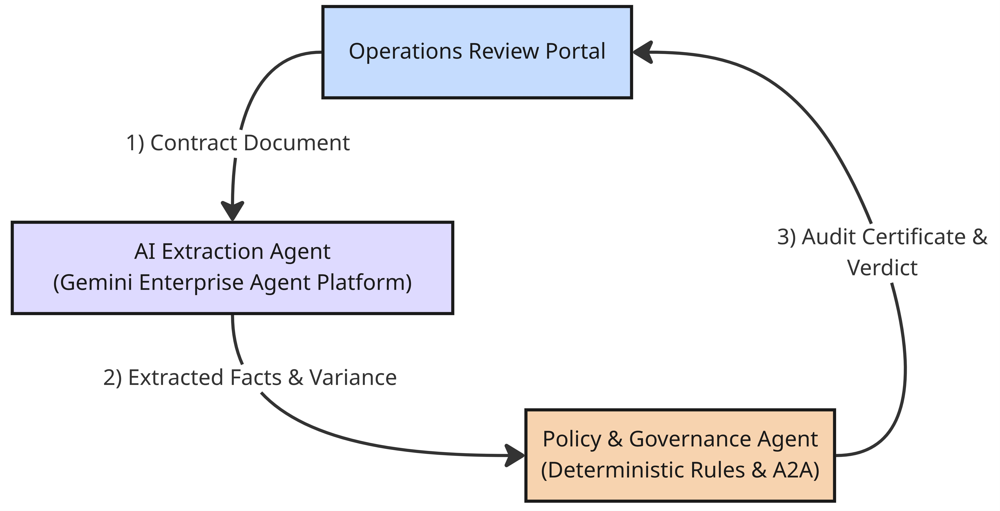

# 🏛️ Enterprise Contract Compliance Application

An end-to-end, multi-agent AI system designed to automate legal contract ingestion, risk analysis, historical price variance detection, and deterministic policy governance on **Google Cloud**.

---

## 🎯 What This Application Does

Enterprise procurement teams process thousands of vendor contracts annually. Manually reviewing contract terms, identifying liability risks, and enforcing internal spending limits is time-consuming and error-prone.

This application provides an **automated multi-agent compliance pipeline**:

1. **📄 Document Ingestion**: Ingests vendor contracts in PDF or text format from local uploads or Cloud Storage vaults.
2. **🧠 AI Legal Fact Extraction**: Uses Gemini AI on **Gemini Enterprise Agent Platform** to automatically extract key legal parameters—including vendor name, contract value, term duration, liability clauses, and insurance floors.
3. **📊 Historical Variance Detection**: Compares contract pricing against historical vendor benchmarks to flag anomalous price spikes (+15% threshold).
4. **🛡️ Autonomous A2A Policy Governance**: Hands off extracted parameters via the **Agent-to-Agent (A2A) Protocol** (JSON-RPC 2.0) to an independent, deterministic Policy Engine in Go that evaluates hard compliance rules ($500k value cap, 5-year max term) and generates an official **Governance Audit Certificate**.
5. **🖥️ Operations Review Portal**: Displays real-time case states, extracted parameter sheets, distributed trace timelines, and audit certificates for procurement review.

---

## 📐 High-Level Application Workflow



> 📄 **Looking for deep technical details?**  
> For full sequence diagrams, service endpoints, A2A JSON-RPC protocol schemas, and OpenTelemetry trace specifications, see [**`ARCHITECTURE.md`**](ARCHITECTURE.md).

---

## 📁 Monorepo Structure

```text
a2a-contract-compliance/
├── extraction-orchestration-agent/   <── Python ADK Agent & FastAPI Gateway (Gemini 2.5 + Agent Platform)
├── compliance-governance-agent/      <── Go Deterministic Policy Engine (A2A Agent Card + Policy Engine)
├── cockpit-frontend/                 <── Interactive Operations Review Portal Dashboard UI
├── EXERCISES.md                      <── Workshop exercise guide & TODOs for Teams A & B
├── ARCHITECTURE.md                   <── Full system architecture & sequence flow diagrams
└── README.md                         <── Application Overview & Guide
```

---

## 🛠️ Workshop & Exercise Guides

This codebase is organized for two collaborative engineering teams:

* **Team A (Python ADK & Agent Platform)**: Focuses on legal fact extraction, historical vendor database variance, and A2A dispatch in `extraction-orchestration-agent/`.
* **Team B (Go Governance Engine)**: Focuses on A2A Agent Card discovery, deterministic policy enforcement ($500k cap, 5-yr term cap), and certificate rendering in `compliance-governance-agent/`.

### 📚 Documentation & Guides
- [**`EXERCISES.md`**](EXERCISES.md): Hands-on workshop coding tasks, TODOs, and verification steps for Teams A & B.
- [**`ARCHITECTURE.md`**](ARCHITECTURE.md): Full system architecture, sequence diagrams, and protocol schemas.
- [**`DEMO_GUIDE.md`**](DEMO_GUIDE.md): Complete executive pitch, 5-step demo flow, code highlights, and Q&A cheat sheet.
- [**`WORKSHOP_FACILITATOR_PLAYBOOK.md`**](WORKSHOP_FACILITATOR_PLAYBOOK.md): Facilitator guide for pacing, troubleshooting, and judging hackathon teams.
